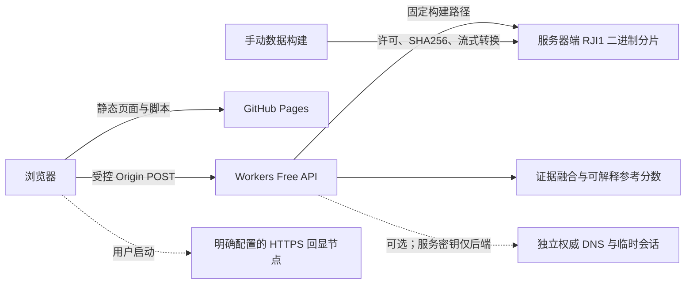

# 架构与接口

浏览器运行 React/TypeScript 界面、复制与本地报告导出。Worker 读取可信 HTTP 连接元数据、校验手动 IP、查询本地公共情报分片，并调用纯函数评分模型。可选模块失败不阻止基础查询。

## 基础 API

| 接口                                | 请求                                     | 响应与用途                                                             |
| ----------------------------------- | ---------------------------------------- | ---------------------------------------------------------------------- |
| `GET /api/capabilities`             | 无 IP 参数                               | 数据版本、来源状态、可选服务与节点配置；不含完整索引                   |
| `POST /api/self`                    | JSON `{}`                                | Cloudflare 可信当前连接的真实公网 IP 与报告；本地预览缺元数据返回受限  |
| `POST /api/lookup`                  | JSON `{ "ip": "有效公网 IPv4 或 IPv6" }` | `IpReport`：归属、参考分数、可信度、证据、来源与时间                   |
| `GET /api/echo` 或 `POST /api/echo` | GET 无参数；POST JSON `{}`               | 本接口实际 HTTP 出口与地址族；同样要求可信边缘信息。GET 可用于受控节点 |
| `POST /api/dns/start`               | JSON `{}`                                | 可选 DNS 会话 ID、秘密、4 个随机探测 URL 与过期时间                    |
| `POST /api/dns/results`             | JSON `{ "id": "…", "secret": "…" }`      | 本次观察到的递归解析器；不能仅凭国家/ASN 差异判泄漏                    |
| `POST /api/dns/delete`              | 与 results 相同                          | 清理临时会话；最长 180 秒自动过期是后备保护                            |

个人结果、错误和限流响应为 `no-store`。`IpReport` 保留 `assessment.riskScore`，新增 `purity` 与自查的离线来源对照 `provenance`。`ALLOWED_APP_ORIGINS` 是前端精确 Origin 白名单。公开回显单独使用 `ALLOWED_ECHO_ORIGINS`。`/_intel/` 仅由服务器资产绑定访问，Pages 产物不包含情报数据。DNS 仅在真实公网验收并启用 `DNS_PUBLIC_VERIFIED` 后，通过鉴权健康检查对前端开放。结果 API 可接收 `enrich: true` 请求本地归属补全。 [数据管道](DATA_PIPELINE.md) · [DNS 上线清单](DNS_LAUNCH.md)

## 可选部署配置

- `DNS_SERVICE_URL`：自有独立服务的 HTTPS 根地址；本地联调才允许 localhost HTTP。`DNS_SERVICE_SECRET` 是至少 32 字符的后端服务秘密，须通过 Worker secret 配置，不能暴露浏览器。服务侧 `DNS_API_KEY` 与之对应；浏览器只能持有本次会话秘密。权威 DNS 区域委派、UDP/TCP 53、TLS 和资源前提见 [服务说明](../services/authoritative-dns/README.md)。
- `ROUTING_NODES`：JSON 数组，每项 `{ "id": "唯一标识", "name": "节点名", "url": "自有HTTPS回显URL", "family": 4或6（可选） }`。浏览器模块按 GET 读取节点 JSON，要求响应含真实 `ip`，可选 `asn`、`country`、`protocol`。本 Worker 的 GET `/api/echo` 可提供该接口；另一个受控节点须把主站 Origin 放入其 `ALLOWED_ECHO_ORIGINS` JSON 数组中，例如 `["https://主站域名"]`，不能使用 `*`。默认空数组保持严格同源，未部署节点则不执行出口比较。
- `FAMILY_ENDPOINTS`：JSON `{ "ipv4": "真实IPv4-only回显URL", "ipv6": "真实IPv6-only回显URL" }`。只有运营者确实控制对应 DNS/网络地址族时才配置；两个双栈 workers.dev 地址不能证明隔离。
- `STUN_URL`：可选自有 STUN 服务标识，使用 `stun:主机:端口` 或 `stuns:主机:端口`。能力接口仅返回经过语法检查的 URL，用户点击后浏览器传给 `iceServers`，默认空数组不请求任何第三方 STUN。配置语法有效不等于实际公网服务已验证；部署与联通情况以测试报告为准。独立协议实现和自部署配置见 [STUN 说明](../services/stun/README.md)。

这些配置默认全部为空/关闭；不自动创建服务器、域名、证书、付费资源或外部账号。公开站点资源连通性是另一种用户主动检测，不提供第三方站点实际出口 IP。

## 部署与验证边界

数据构建、应用生产构建和 Wrangler dry-run 都是本地验证；正式 `deploy` 是单独的审批后操作。没有真实上线和资源压测证据时，不宣称全球可用、生产 CPU 满足 10 ms、公网 DNS 委派成功或 STUN 已联通。
